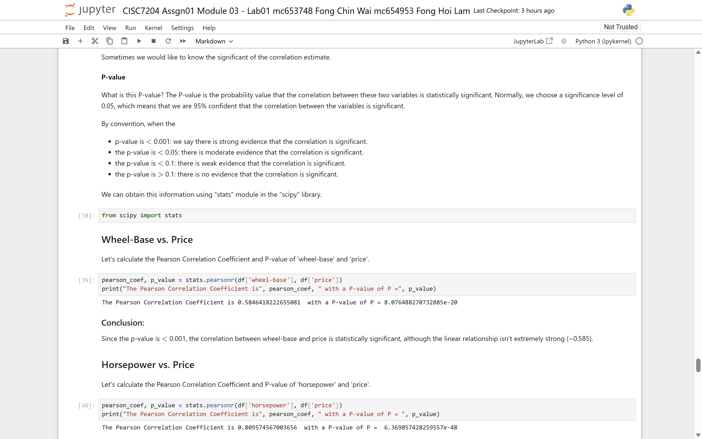
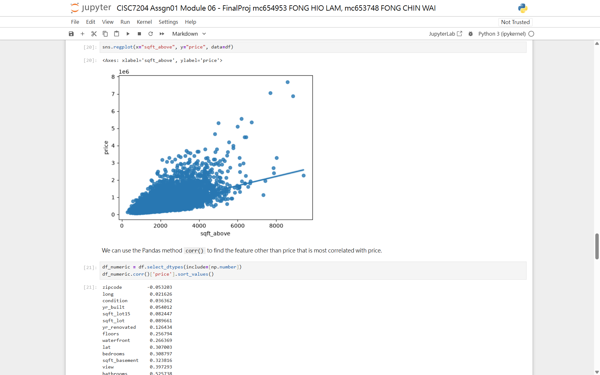
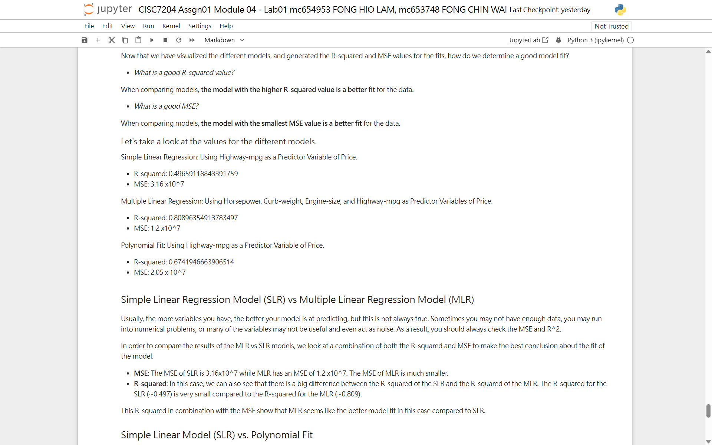

# FONG HIO LAM

**Data Science / AI Graduate Student · University of Macau**

Interested in **data analysis** and **machine learning** — building end-to-end pipelines from raw data to models, and turning insights into clear visualisations.

## Technical Skills

- **Languages & Tools**: Python, Jupyter Notebook
- **Data Manipulation**: pandas, numpy
- **Visualisation**: matplotlib, seaborn
- **Machine Learning**: scikit-learn (regression, cross-validation, Ridge, GridSearchCV), PyTorch
- **Workflow**: data cleaning, EDA, model development, hyper-parameter tuning

## Projects

### CISC7204 Assignment 1 — Price Regression Full-Pipeline Analysis

A complete machine learning learning project covering the full workflow: data import → data cleaning → exploratory data analysis (EDA) → model development → cross-validation & hyper-parameter tuning.

- **Research questions**: Can we predict car prices and laptop prices from technical specifications? Which features drive house prices in King County, and how do BMI / smoker status affect medical insurance costs?
- **Methods**: data cleaning (missing-value imputation, normalisation, dummy variables), EDA (correlation heatmaps, scatter/box plots), simple / multiple / polynomial linear regression, scikit-learn Pipeline, k-fold cross-validation, Ridge regression, GridSearchCV
- **Key findings**: car price correlates strongly with engine size; higher-degree polynomial fits overfit quickly and Ridge with a tuned alpha stabilises the model; sqft living area dominates house price; smoker status is the largest driver of insurance charges
- **Visualisations**:

- **Repository**: [github.com/FongHioLam-mc654953/data-science-project](https://github.com/FongHioLam-mc654953/data-science-project)
- **Status**: Completed
